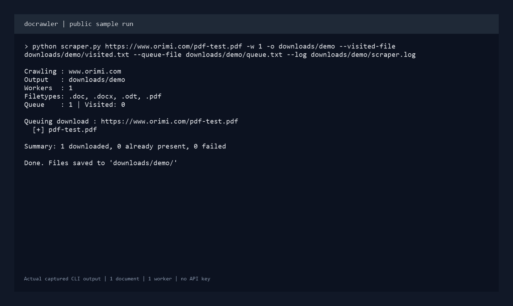

# docrawler

Collect documents from a website without opening and saving every link by hand. docrawler follows links within a domain, finds document URLs, and downloads them into a local folder. It is useful for gathering reports, policy documents, and reference material before indexing or processing them in another workflow.

Page discovery runs sequentially. Document downloads run in a configurable thread pool, and discovered/visited URLs are saved to disk.

## Preview



A small public run against [Orimi's sample PDF](https://www.orimi.com/pdf-test.pdf), limited to one document and one worker. The image renders the captured command and actual terminal output, also saved in [docs/demo-output.txt](docs/demo-output.txt).

## What it does

- Follows same-domain HTML links, including subdomains of the selected host.
- Downloads PDF, DOCX, DOC, and ODT files by default, with configurable extensions.
- Retries transient HTTP failures with exponential backoff.
- Saves crawl state and skips files already present in the output folder.
- Includes small tools to deduplicate, subtract, and merge URL state files.

## Run locally

Requires Python 3.10 or newer. No API key or account is needed.

```bash
git clone https://github.com/miahela/docrawler.git
cd docrawler
python -m venv .venv
```

Activate the virtual environment:

```powershell
# Windows PowerShell
.\.venv\Scripts\Activate.ps1
```

```bash
# macOS / Linux
source .venv/bin/activate
```

Install dependencies:

```bash
python -m pip install -r requirements.txt
```

Configuration is optional. To customize defaults, copy `.env.example` to `.env`:

```powershell
# Windows PowerShell
Copy-Item .env.example .env
```

```bash
# macOS / Linux
cp .env.example .env
```

Run from the project directory, replacing the sample URL with your target:

```bash
python scraper.py https://example.com
```

By default, documents go into `downloads/`, state goes into `visited.txt` and `queue.txt`, and errors go into `scraper.log`. These paths are relative to your current working directory. Nested parent folders are created when needed.

## Configuration

The `.env` file beside `config.py` supplies optional defaults. Existing environment variables override `.env`; CLI flags override the matching defaults. `.env` is ignored by Git.

| Variable | Default | Purpose |
|---|---|---|
| `DOCRAWLER_OUTPUT_DIR` | `downloads` | Download folder |
| `DOCRAWLER_VISITED_FILE` | `visited.txt` | Visited URL state |
| `DOCRAWLER_QUEUE_FILE` | `queue.txt` | Discovered URL state |
| `DOCRAWLER_LOG_FILE` | `scraper.log` | Log file |
| `DOCRAWLER_EXTENSIONS` | `.pdf .docx .doc .odt` | Space-separated document extensions |
| `DOCRAWLER_WORKERS` | `5` | Download threads, at least 1 |
| `DOCRAWLER_PAGE_TIMEOUT` | `15` | Page request timeout in seconds, greater than 0 |
| `DOCRAWLER_DOWNLOAD_TIMEOUT` | `30` | Download request timeout in seconds, greater than 0 |
| `DOCRAWLER_RETRIES` | `3` | HTTP retry limit, at least 0 |
| `DOCRAWLER_BACKOFF` | `1.0` | Retry backoff factor, at least 0 |
| `DOCRAWLER_USER_AGENT` | Original Chrome-style user agent | Optional request identity override |

Use `python scraper.py --help` for all CLI options. A few examples:

```bash
# PDFs only, with a separate output folder
python scraper.py https://example.com -e pdf -o reports

# More download threads and additional file types
python scraper.py https://example.com -w 10 -e .pdf .xlsx .pptx

# Include sibling subdomains under example.com
python scraper.py https://docs.example.com --domain example.com

# Keep separate state and logs for each target
python scraper.py https://example.com --visited-file state/example-visited.txt --queue-file state/example-queue.txt --log logs/example.log
```

Use separate output/state files for unrelated sites. Repeat the command with the same state paths to resume discovery and retry failed downloads. Downloads enter the visited state only after a successful save, or when the final file already exists. For a fresh crawl, choose new state paths.

## Errors and current limits

Invalid URLs, worker counts, and environment settings produce a clear startup error. File access failures report the affected path. Failed page requests are logged; failed downloads are logged and printed while other downloads continue. The run summary reports downloaded, already-present, and failed documents for that run. Failed downloads stay queued for the next run. The command can finish with failures, so check the summary and log.

- HTML pages are still marked visited before fetching, so failed page discovery is not automatically retried. Downloads that older versions already marked visited need their URLs removed from the visited file once before they can be retried.
- Downloads are written to `.part` files before replacing the final filename. Failed writes may leave a `.part` file that the next attempt overwrites.
- Documents are saved by URL basename. Different URLs with the same filename can collide or be skipped. Existing files are not checked for completeness.
- Files are detected by URL extension. JavaScript-rendered links and download endpoints without an extension are not discovered as documents.
- The crawler follows ordinary HTTP redirects; redirect destinations are not separately restricted to the selected domain.
- There is no automatic robots.txt enforcement, page limit, or crawl delay. Choose a target and concurrency appropriate for the site.

## State utilities

```bash
# Deduplicate a URL file in place
python utils.py dedup queue.txt

# Remove visited URLs from a queue file
python utils.py subtract queue.txt visited.txt

# Merge several URL files
python utils.py merge part1.txt part2.txt -o combined.txt
```

`dedup` and `subtract` overwrite their input unless you supply `-o`. Missing/unreadable required files produce a clear error. `merge` warns and skips missing inputs.

## Checks

Run the local resume regression checks with `python -m unittest discover -s tests -v`. They cover a failed HTTP download, a failed final save, and a later successful retry without repeating completed downloads.

## Stack

Python, requests, BeautifulSoup, and urllib3 handle HTTP, HTML parsing, and retries. The standard library provides the CLI, file state, and concurrent downloads. python-dotenv loads optional local settings; lxml remains in the existing requirements.

```text
docrawler/
  scraper.py         Crawl and download CLI
  config.py          Validated environment defaults
  utils.py           State file utilities
  .env.example       Optional configuration template
  requirements.txt   Runtime dependencies
  docs/screenshot.png  Public sample run and summary
```
